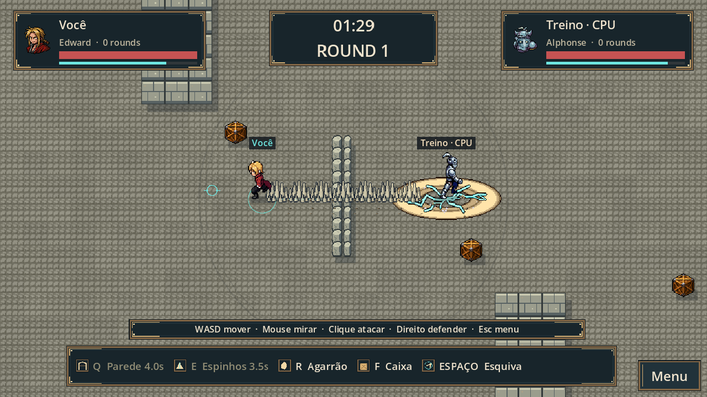
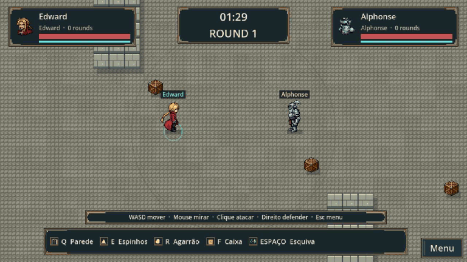
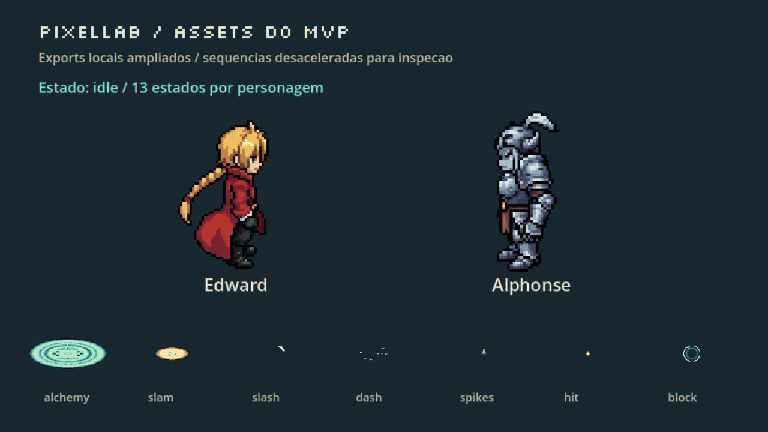
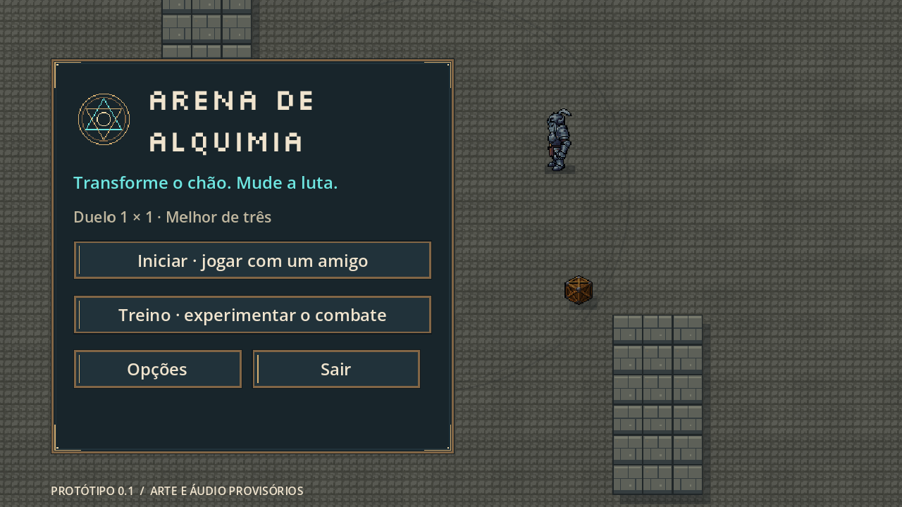
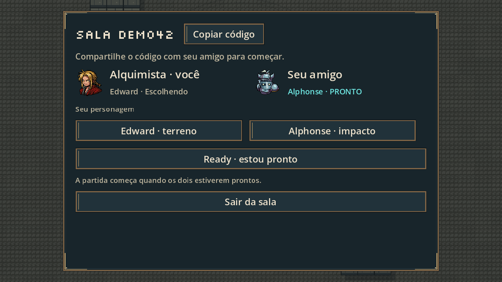
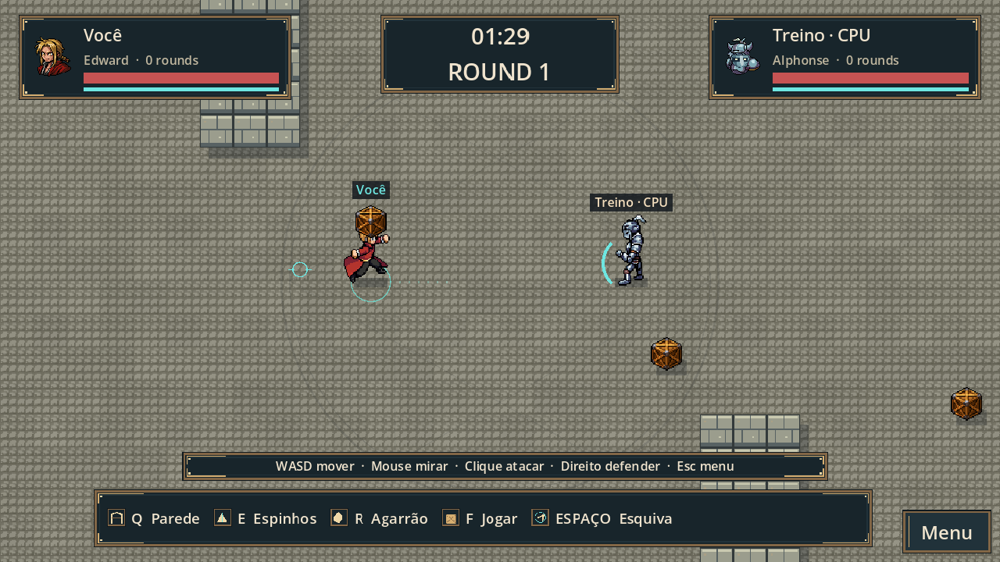
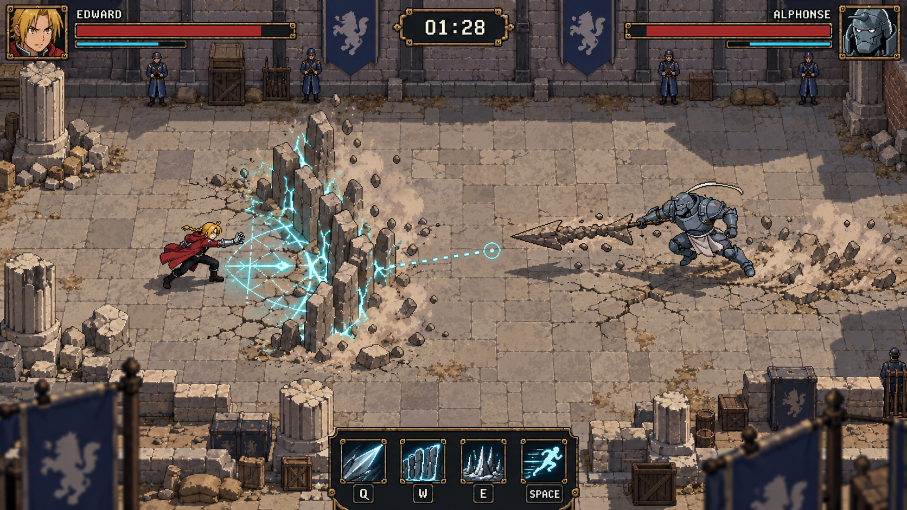
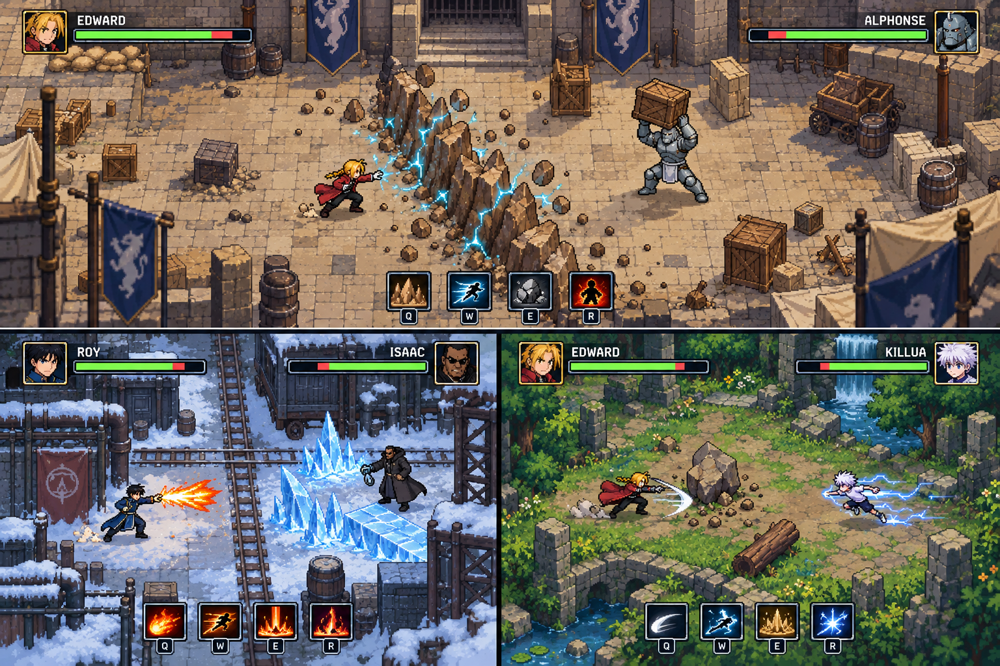

# Arena de Alquimia — protótipo 0.1

Duelo 1 × 1 em tempo real: **mire, esquive, transforme o chão e use objetos para mudar a luta**. Edward e Alphonse se enfrentam em uma arena maior que a tela, com salas privadas, Ready e melhor de três.



[Baixar o MVP para Windows e o servidor Linux](https://github.com/AbnerSilvaBarbosa/arena-de-alquimia/releases/tag/v0.1.0) · [Plano do MVP](MVP.md) · [Instalação pelo Hermes](server/HERMES.md)

## O jogo em movimento



[Assistir ou baixar o vídeo de combate em MP4](docs/media/combat.mp4)

Sequência automatizada de 13 segundos, gravada no renderer do Godot com a simulação e os assets reais: terreno, golpes, defesa, agarrão, investida, esquiva e transporte/arremesso de caixa. Há cortes entre três situações preparadas; não é uma partida humana pela internet. O vídeo é exportado a 30 FPS, independentemente da taxa de renderização durante uma partida.

## Pixel arts e animações



[Vídeo dos assets em MP4](docs/media/assets.mp4) · [Galeria estática ampliada](docs/media/pixel-art.png) · [Detalhes e origem dos assets](assets/pixellab/README.md)

Os dois personagens têm **13 estados visuais**: idle, caminhada, ataque, conjuração, defesa, agarrão, pegar, carregar, caminhar carregando, arremessar, esquiva, reação a dano e KO. A galeria desacelera as ações para inspecionar os desenhos; o ritmo do combate é o do vídeo acima. Alguns estados reutilizam poses e frames. Idle tem oito direções e as ações têm quatro; Q/E compartilham a pose corporal, com efeitos distintos.

## Telas do MVP

| Menu inicial | Sala e seleção |
| --- | --- |
|  |  |

<details>
<summary>Ver transporte de objetos</summary>



</details>

## Para onde queremos levar o visual

Estas são **as duas imagens-conceito originais da conversa**, geradas antes do desenvolvimento. São referência para cenário, efeitos e composição da versão futura; as capturas e os vídeos acima mostram o que está implementado hoje.

### Pátio de Amestris



A direção é enriquecer o cenário com arquitetura, bandeiras, materiais e efeitos de transmutação, mantendo a leitura dos personagens e das áreas de ataque. A lança e outros elementos desta ilustração não fazem parte do kit atual.

### Outros mapas, personagens e universos



Exploração visual de um pátio militar, uma região nevada e uma floresta. Roy, Isaac e um possível encontro com Hunter × Hunter aparecem como ideias para expansão; **o MVP atual inclui somente Edward, Alphonse e um mapa**. Estes conceitos não são screenshots jogáveis nem uma promessa de conteúdo pronto.

## Sobre a implementação

Projeto Godot jogável, desenvolvido no Mac para cliente Windows e servidor Linux. Sprites, animações, efeitos visuais e elementos de interface foram produzidos no **PixelLab** e exportados para arquivos locais. A arte é uma primeira versão do MVP; música e efeitos sonoros são originais, sintetizados por código. O jogo não chama a API do PixelLab nem precisa de chave para funcionar. Os títulos usam Silkscreen; a licença acompanha os pacotes.

## Jogar neste Mac

Abra `Jogar no Mac.command` ou importe `project.godot` no Godot e pressione **F6/F5** para executar a cena/projeto. O lançador procura Godot em Downloads e Applications; também aceita `GODOT_BIN`.

No menu, **Treino** permite escolher Edward ou Alphonse e jogar contra um bot simples, sem servidor externo.

## Jogar com duas pessoas

No menu, escolha **Iniciar**. Informe o mesmo endereço e porta de servidor nos dois clientes. Um cria a sala e compartilha o código de seis caracteres; o outro entra com o código. Escolham os personagens e cliquem Ready. A partida começa após ambos carregarem a arena.

Para testar no mesmo Mac: no primeiro cliente, use **Ligar servidor local para testes**, depois **Criar sala**. Abra outro cliente com o lançador e entre em `127.0.0.1`, porta `7000`, usando o código. O servidor local fica vinculado ao primeiro aplicativo e encerra quando ele fecha. Para dois computadores na mesma rede, o segundo usa o endereço LAN do computador servidor. Para internet, usar a VPS com porta UDP liberada.

O botão de servidor local destina-se a testes. O fluxo final usa a VPS, sem o jogador precisar hospedar.

## Windows

Build gerada em `builds/windows/Arena.exe`; pacote de distribuição `builds/Arena-Windows-0.1.zip`. Extrair o pacote e abrir `Arena.exe`. Não precisa instalar o Godot.

A exportação foi feita neste Mac usando o template oficial 4.7.2. A execução nativa em Windows ainda precisa ser validada num computador Windows.

## Controles

| Ação | Controle |
| --- | --- |
| Mover | WASD |
| Mirar | Mouse |
| Golpe básico | Clique esquerdo |
| Defender na direção da mira | Segurar clique direito |
| Esquiva | Espaço |
| Habilidade 1 / 2 | Q / E |
| Agarrão | R |
| Pegar/arremessar uma caixa próxima | F |
| Menu | Esc |

Edward: automail, parede temporária destrutível, espinhos em linha com aviso. Alphonse: soco, investida, impacto em área com aviso. Defesa reduz dano frontal; agarrão ignora defesa; esquiva gasta resistência. Caixas podem ser carregadas e arremessadas, quebrando no impacto. Não se pode lutar enquanto carrega uma caixa.

O primeiro jogador a ganhar dois rounds vence. Cada round dura 90 segundos; no tempo limite vence quem tiver mais vida. Empate repete o round sem ponto. O cenário reinicia entre rounds. A revanche depende dos dois; sair durante o combate interrompe a disputa e devolve o rival ao lobby.

## Servidor Linux / VPS

Build: `builds/linux/arena-server`. Pacote: `builds/Arena-Server-Linux-0.1.zip`. O processo deve executar com `--headless`; o preset dedicado já seleciona o modo servidor. Porta padrão 7000/UDP, alterável com `-- --port=7001`.

Exemplo em Linux:

```sh
./arena-server --headless -- --server --port=7000
```

Instruções de instalação e serviço systemd: [server/README.md](server/README.md). A VPS não foi alterada; o usuário e o Hermes farão a instalação. O pacote inclui um roteiro HERMES.md.

## Organização

- `scripts/room.gd`: simulação autoritativa, colisões, golpes, caixas, paredes e rounds.
- `scripts/net.gd`: ENet, salas isoladas, seleção/Ready, snapshots comprimidos, canais e limites de comandos.
- `scripts/arena.gd`: cenário, sprites PixelLab, efeitos em camadas, câmera, previsão local e interpolação remota.
- `scripts/pixel_assets.gd`, `pixel_fx.gd`, `pixel_ui.gd`, `pixel_environment.gd`: carregamento e reprodução dos assets locais.
- `assets/pixellab/`: sprites, spritesheets, retratos, atlas de UI, cenário e receitas de origem.
- `scripts/main.gd`: menu, lobby, HUD, opções, entrada e resultado.
- `scripts/sound.gd`: efeitos e loops musicais originais sintetizados.
- `export_presets.cfg`: cliente Windows e servidor Linux.
- `MVP.md`: plano de produto e escopo futuro.

Servidor simula a 60 Hz e envia snapshots a aproximadamente 25 Hz. Cliente prevê o movimento local e interpola o remoto. Eventos de lobby e ações são confiáveis; movimento/estado usam canais separados. Não há rollback completo ou compensação histórica de acertos.

## Verificação reproduzível

Substitua `godot` pelo caminho do executável instalado.

```sh
godot --headless --path . --script tests/simulation_test.gd
python3 tests/run_network.py --godot /caminho/do/godot --rtt-ms 100 --loss 0.01
```

O teste de rede lança um servidor e dois clientes reais. Verifica criar/entrar, Edward/Alphonse, Ready, carregamento e movimento sincronizado; também sala cheia, código inexistente e versão incompatível. Acrescente `--duel` para completar dois rounds, confirmar o resultado 2–0 e votar na revanche com reset de vida/placar nos dois clientes. O proxy local adiciona atraso em cada sentido, jitter e perda. Esse teste automatizado não substitui jogar uma partida real pela internet.

Capturas visuais: `python3 tests/capture_ui.py --godot /caminho/do/godot`. Medição renderizada: `godot --path . --script tests/performance.gd`. Integridade e reprodução das animações: `godot --headless --path . --script tests/assets_test.gd`.

## Limitações desta versão

- Arte de primeira versão: idle em oito direções; ações em quatro direções, com escolha da orientação cardinal mais próxima na diagonal. Q/E compartilham pose de conjuração; agarrão, defesa e transporte derivam de poses existentes. Ainda precisam de direção de animação e balanceamento com partidas humanas.
- Áudio sintetizado provisório; sem dublagem ou trilha do anime.
- Bot simples; sem treino configurável, gamepad ou remapeamento de teclas na interface.
- Sem autenticação, ranking, matchmaking, persistência ou reconexão no meio da partida.
- Até quatro salas por configuração inicial; capacidade real da VPS não foi medida.
- Execução nativa em Windows/Linux e partida humana pela VPS ainda não verificadas.
- Interações físicas usam colisões 2D controladas; não há altura, rampas ou salto.
- O comportamento sob latência simulada foi verificado em testes de protocolo; o ajuste fino da sensação de golpes ainda exige sessões humanas.

Próxima validação: partida entre duas pessoas, seguida de instalação e teste na VPS. Refinar a arte e o ritmo dos golpes com essa experiência real de jogo.


## Reconstruir as entregas

Use Godot 4.7.2 e os templates de exportação correspondentes. Os presets
apontam para os dois templates release em `builds/templates/`, que não entram
no pacote de código-fonte. `python3 tests/fetch_templates.py` baixa apenas esses
binários do arquivo oficial por HTTP Range e interrompe se o servidor tentar
entregar o arquivo completo.

Depois, rode:

```sh
python3 tools/build_release.py --godot /caminho/do/godot
```

O script exporta cliente Windows/servidor Linux e cria os três ZIPs em
`builds/`. Cache do editor, arquivos locais de configuração e credenciais não
entram no pacote de código. Para modificar a arte, veja `assets/pixellab/README.md`.
